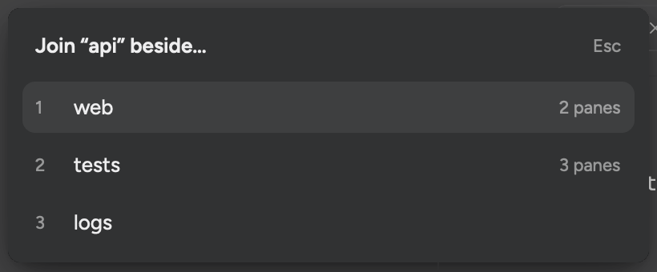

# Join tabs

A mod for [Herdr](https://herdr.dev) that puts two tabs side by side, like VS Code's split editor. Press **⌘\\**, pick a tab, and the one you're in joins it on the right. It works in reverse too: move a pane out of a split tab into a tab of its own. Shells and agents keep running throughout.



## Install

1. Copy `mods/join-tabs` into `~/.config/herdr-app/mods/`.
2. Merge `keys.json` into your own `~/.config/herdr-app/keys.json`. It binds ⌘\\. On Windows or Linux, pick a key such as `ctrl-shift-j`.
3. Check it:
   ```sh
   herdr-app check ~/.config/herdr-app/mods/join-tabs
   ```

It works with any layout. The [Minimal Frost](https://github.com/denizeroglu/herdr-minimal-frost) layout builds on it: drag a pane's title onto a tab to join it, or onto empty space in the tab bar to give it a tab of its own. Its right-click menus also offer **Join with…** and **Move to new tab**.

## Use

- **⌘\\** in a tab: pick another tab in the same space (↑/↓ and Enter, 1–9, or a click). Esc cancels.
- **Several panes:** the first goes to the right of the target's panes, and the rest stack below it. The emptied tab closes.

Other mods and layouts can open it with props:

```js
// join this tab beside another
openOverlay({ mod: "join-tabs", kind: "popup", width: 400, props: { tab, to } })
// join one pane into a tab
openOverlay({ mod: "join-tabs", kind: "popup", width: 400, props: { action: "join-pane", terminal, to } })
// move one pane out of a split tab to a new tab
openOverlay({ mod: "join-tabs", kind: "popup", width: 400, props: { action: "separate", terminal } })
```

## Notes

- Herdr has no join command, so this parks each terminal (its pane goes, the program keeps running) and gives it a pane again beside the target. [RECIPE.md](RECIPE.md) has the details.
- Each join splits the rightmost pane in half, so widths end up uneven. Drag the dividers to even them out.
- No network access, no programs run and no files read.

## License

Apache License 2.0, see [LICENSE](LICENSE).
