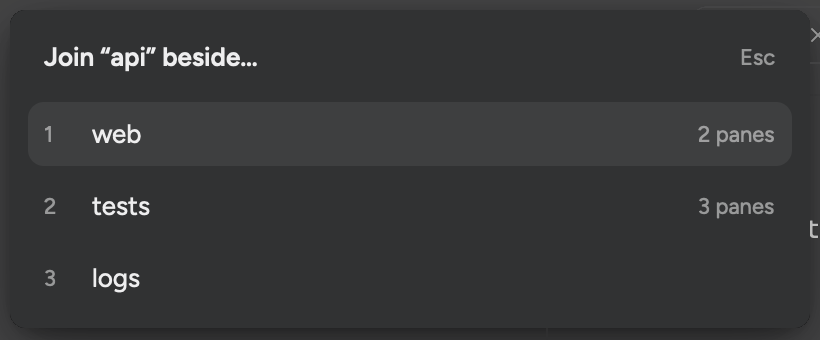

# Join tabs

Put two tabs side by side in one tab, like VS Code's split editor, without restarting what runs in them. Press ⌘\\, pick a tab, and the tab you're in moves beside it on the right. The reverse moves one pane out of a split tab into a tab of its own.

## What you see

- **A popup**, 400 px wide, near the top of the window (or at the pointer when a menu opens it). It uses the theme's `popover` colour with 12 px corners.
- **Title row:** "Join “<this tab>” beside…" in semibold, with **Esc** on the right in the dim colour. The tab name is the one the tab bar shows: a name the person gave, or the agent's live title.
- **One row per other tab** in the same space, in tab order. Each row is 32 px high, with its number (1–9) in the dim colour, the tab's name, and "N panes" in the dim colour when the tab is split.
- **The highlighted row** uses the theme's `selected` fill, and hovered rows use `hover`.
- **Empty states:** "No other tab in this space", or "No tab to join".
- **While working,** the title reads "Joining…" (or "Moving…" when separating) and the rows are hidden.

## How it behaves

- **Picking:** ↑/↓ moves the highlight and Enter joins it. 1–9 joins that row directly, a click joins a row, and Esc closes.
- **Join:**
  - Every pane of the current tab is parked (its pane goes, the program keeps running).
  - The target tab is shown and its last pane focused.
  - The first parked terminal gets a pane to the right, and each further one goes below the previous.
  - The emptied tab closes, and the view stays on the joined tab.
- **Join one pane** (`action: "join-pane"`): the same, for a single terminal.
- **Separate** (`action: "separate"`): one pane of a split tab is parked and gets a pane again as a new tab in the same space. The tab is then renamed to "" so it follows its agent's title. A pane alone in its tab is left as it is.
- **Failure:** if a pane hasn't arrived within 3 seconds, the popup closes with an error notification. The terminals are still running without a pane: they show in the agents list, and `terminal.keep` restores them.
- **Agent status:** working, blocked, done and idle travel with each terminal, because nothing restarts.

## Built from

- **`mods/join-tabs`:** one popup mod. `mod.json` sets `{ "kind": "popup", "at": "top", "offset": 40, "width": 400 }`.
- **Props:**
  - `tab`: defaults to `focused().tab`.
  - `to`: when set, joins at once without asking.
  - `action`: `"join-pane"` or `"separate"`, each with `terminal`.
- **Herdr functions:** `spaces()`, `panes()`, `focused()`, `run`, `closeOverlay`, `notify`, `theme()`, and `cx.timer.after` for the waits.
- **Commands, in order:**
  - **Join:** `terminal.park` for each pane → wait 400 ms → `tab.select {id}` → `pane.focus {pane}` on the target's last pane → for each terminal, `terminal.keep {terminal, place: "right"}` (then `"down"`), checking `panes()` every 100 ms, resending once after 1 s and giving up after 3 s → `pane.focus` on the pane that arrived.
  - **Separate:** `terminal.park` → wait 400 ms → `terminal.keep {terminal}` (a new tab) → `tab.rename {id, name: ""}`.
- **Programs run:** none. **Network:** none. **Files read:** none.
- **`keys.json`:** `global` → `cmd-\` opens it.

## Watch out

- **Herdr has no join or move-pane command.** `terminal.keep` with `place: "right"` / `"down"` splits beside the *focused* pane, so focus the target pane first.
- **Park and keep are asynchronous.** They return `pending: true` and take effect once herdr-core confirms them. Calling `terminal.keep` straight after `terminal.park` can be lost, so wait, check `panes()` and retry once.
- **New tab name:** `terminal.keep` without a place names the new tab after the terminal's address ("t19"). Rename it to "" so it behaves like an unnamed tab.
- **Uneven widths:** each join halves the focused pane, and Herdr has no command to even out pane sizes.
- **Same space only:** joining only offers tabs in the same space. Moving between spaces is a separate job (see [move-to-space](https://github.com/denizeroglu/herdr-move-to-space)).
- **Briefly unprotected:** while parked, which takes under a second, a terminal isn't protected against a crash of herdr-core itself.
- **Your keys.json:** merging `keys.json` into your own stops Herdr from adding new default shortcuts to it on updates.

## Done when

- `herdr-app check mods/join-tabs` passes.
- With two one-pane tabs A and B in a space, ⌘\\ in B lists A. Picking it leaves one tab: A on the left, B on the right, both still showing their earlier output. Tab B is gone.
- Joining a tab with two panes puts its first pane on the right and its second below that.
- `action: "separate"` on a pane of a split tab moves it to a new tab, with its output intact. On a one-pane tab it does nothing.
- Esc closes the popup without changing anything.
